

Team 04 — Project A

SplitSmart Implementation Document

CSCI 310 Project 2.3 · Version 2.0 · October 2026

Zachary Chung (zchung@usc.edu) · Aux Devarapalli (adevarap@usc.edu) · Edward Zhao (ebzhao@usc.edu) · Swayam Parekh (swayampa@usc.edu) · Brian Shi (brianshi@usc.edu)

Customer TA: Yuzhou Fang

**Contents**

1. Project Title and Authors
2. Preface
3. Introduction
4. Architectural Design Change
5. Detailed Design Change
6. Requirements Change
7. Appendix A — Requirement traceability
8. Appendix B — Extra features
9. Appendix C — Verification

# 1. Project Title and Authors

**Project:** SplitSmart (Project A) — an Android app for recording and splitting shared expenses
among USC students and alumni.

**Team number:** 04

| Team member | USC email |
|---|---|
| Zachary Chung | zchung@usc.edu |
| Aux Devarapalli | adevarap@usc.edu |
| Edward Zhao | ebzhao@usc.edu |
| Swayam Parekh | swayampa@usc.edu |
| Brian Shi | brianshi@usc.edu |

# 2. Preface

This is the Project 2.3 implementation document for SplitSmart. It records how the working
Android application differs from the design we submitted in Project 2.2, why each change was
made, and which requirements from Project 2.1 were clarified or changed during implementation.
Wherever the implementation departs from the earlier design, this document includes the revised
architectural and detailed design so that the diagrams here match the delivered source code.

**Expected readership**

- Customer TA: Yuzhou Fang
- CSCI 310 course staff
- Team 04 members, as the reference for maintaining and extending the code

**How changes are marked.** Every departure from the Project 2.2 design is labeled so it is easy
to find:

- In tables, each item is labeled NEW (did not exist in 2.2),
  CHANGED (exists but was modified) or
  UNCHANGED.
- In diagrams,  green boxes and **bold green** members are new;
   orange boxes and **bold orange** members or messages are
  changed; white means unchanged from Project 2.2.
- Each change has an identifier (AC-n for architecture, DC-n for detailed design, RC-n for
  requirements) that the other sections refer to.

**Version history**

| Version | Date | Description |
|---|---|---|
| 1.0 | October 2026 | Project 2.2 design document (architecture and detailed design). |
| 2.0 | October 2026 | Project 2.3 implementation: all features implemented; this document records the design and requirement changes. |
| 3.0 | October 2026 | Optional extensions implemented: remove a member, leave a group, transfer ownership (RC-10), and live updates (RC-11). Changes AC-5, AC-6 and DC-9; Figures 9 and 10. |

As in our earlier documents, whole version numbers mark completed features and decimal numbers
mark smaller changes to existing ones.

# 3. Introduction

SplitSmart is implemented as a native Android application in Java (package
`com.team04.splitsmart`, Android 8.0 / API 26 and newer). All five feature areas from the
customer description are implemented — user and group management, expense management, expense
splitting, balance calculation, and the history, settlements and monthly summary features
(FR 1.1 – FR 5.7) — together with the four non-functional requirements (NFR 1 – NFR 4).

The architecture from Project 2.2 held up well during implementation. The application is still
organized into the same three layers and six components: UI Views (C1), ViewModels (C2), Business
Logic and Model (C3), Repositories (C4), Firebase Authentication (C5) and Cloud Firestore (C6). We
kept the four decisions that shaped the design: MVVM in the presentation layer, repositories as
the only classes that use Firebase, money as integer cents, and balances computed on demand from
the transaction history.

The changes we did make fall into four groups:

1. **Security and correctness of shared data.** Registration now creates the login first and then
   reserves the USC ID inside a Firestore transaction (AC-3); the Firestore security rules now
   validate document contents and allow the owner to delete a whole group (AC-4); and the
   settlement limit is re-checked against fresh data at the moment of saving (DC-7).
2. **Structure needed by a real Android app.** An application class acts as the composition root
   (AC-1), the data layer translates Firebase errors into app errors (AC-2), shared base classes
   remove duplicated screen code, and the group screen became a tabbed screen with a new Members
   tab (DC-1).
3. **Signatures that the 2.2 diagrams left incomplete or inconsistent**, such as the edit and
   delete operations that FR 2.7 and FR 5.3 require, and the `DataCallback` method that had two
   different names in the 2.2 class and sequence diagrams (DC-3 to DC-6).
4. **Requirement clarifications** discovered while building the forms, such as password length,
   an upper limit on amounts, and how percentage rounding treats 0% participants (Section 6).
5. **Optional extensions from the customer description**, which we analysed in the first version
   of this document and then implemented: the owner can remove a member or transfer ownership,
   any other member can leave, nobody can leave while they still owe or are owed money (AC-6,
   DC-9), and every screen updates live when another member changes the group (AC-5).

Section 4 describes the architectural changes and shows the revised block diagram. Section 5
describes the detailed design changes, with the revised class table, class diagrams, data storage
schema, security rules and sequence diagrams. Section 6 lists the requirement changes and analyses
their impact on the design. The appendices map every requirement to the code that implements it,
list the extra features we added, and summarize how the implementation was verified.

# 4. Architectural Design Change

## 4.1 Components after implementation

| Component | Responsibility | Status | Change |
|---|---|---|---|
| C1 UI Views | Display screens, collect input, show errors and confirmations | CHANGED | Shared base classes; tabbed group screen with a Members tab (DC-1) |
| C2 ViewModels | Hold screen state; coordinate business logic and data access | CHANGED | One-time events and form-state classes (DC-3); own the live-update subscriptions (AC-5) |
| C3 Business Logic and Model | Validation, money, splits, balances, history filters, summaries | UNCHANGED | Responsibilities unchanged; some signatures refined (DC-4, DC-5) |
| C4 Repositories | Read and write users, groups and transactions through Firebase | CHANGED | Error translation boundary (AC-2); registration flow (AC-3); snapshot listeners for live updates (AC-5) |
| C5 Firebase Authentication | Registration, login, logout, sessions | UNCHANGED | — |
| C6 Cloud Firestore | Shared storage and server-side access rules | CHANGED | Rules also validate contents; owner may delete a group's transactions (AC-4); leave, remove and transfer-ownership rules (AC-6); pushes changes to listening phones (AC-5) |
| Application (`SplitSmartApp`) | Builds the shared dependencies once per process | NEW | Composition root (AC-1) |

## 4.2 Revised block diagram

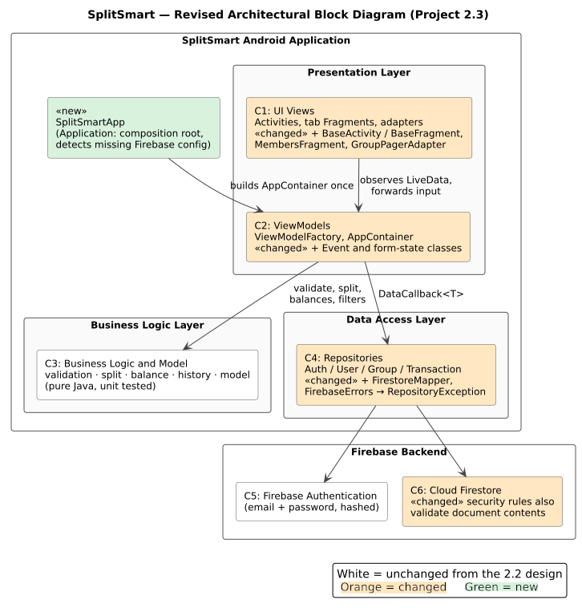

Figure 1 (revised): SplitSmart architectural block diagram. Orange components changed; green is new.

The dependency rules from Project 2.2 are unchanged: views talk only to ViewModels; ViewModels use
the business-logic engines and the repositories; only repositories reach Firebase. Every phone
reads and writes the same Firestore database, so one member's changes reach the others when a
screen is refreshed or reopened (NFR 3). In addition, open screens now receive other members'
changes immediately through Firestore snapshot listeners (AC-5, the dotted arrow in Figure 1).

## 4.3 Changes and rationale

**AC-1 NEW Application-level composition root.**
*What changed:* `SplitSmartApp` (an `android.app.Application` subclass) creates the
`AppContainer` once when the process starts. It also checks whether Firebase was configured; if
`app/google-services.json` is missing, the container is not created and the launch screen
explains how to finish the setup instead of crashing.
*Rationale:* The 2.2 design had an `AppContainer` but no owner for it. Activities and ViewModels
are recreated on rotation, so the container must live in an object with the lifetime of the
process. The configuration check lets every teammate build the project and run the unit tests
before the shared Firebase project exists.

**AC-2 NEW Error translation boundary in the data layer.**
*What changed:* Repositories never pass Firebase exceptions upward. `FirebaseErrors` converts
them into a `RepositoryException` whose message is written for the user ("You appear to be
offline…", "An account with this USC email already exists.") and which records whether the item
is permanently gone (`isNotFound()`).
*Rationale:* The 2.2 rule "only repositories use Firebase" would otherwise be broken by every
ViewModel that inspects a `FirebaseFirestoreException`. Distinguishing "deleted" from "offline"
also lets a group screen close itself when the owner deletes the group on another phone, while a
temporary network error only shows a message.

**AC-3 CHANGED Registration order and USC ID reservation.**
*What changed:* In 2.2 (Figure 3) the app read `uscIds/{uscId}` before creating the login, then
created the login, then wrote both documents. Now the login is created first; the USC ID check
and both writes happen in one Firestore transaction; if the USC ID is taken (or the write fails)
the new login is deleted again and the user sees "An account with this USC ID already exists."
*Rationale:* The old order required signed-out users to read the `uscIds` collection, which would
let anyone test which USC IDs are registered (NFR 4). It also left a gap between the check and the
write in which two people could claim the same USC ID. Doing the check inside the transaction
closes that gap (FR 1.2), and the security rules additionally refuse to overwrite an existing
reservation. The revised flow is Figure 3 in Section 5.6.

**AC-4 CHANGED Server-side rules enforce contents, not only access.**
*What changed:* In addition to the 2.2 access rules, `firestore.rules` now checks that a profile
uses a `@usc.edu` email matching the login and a 10-digit USC ID; that only the name of a profile
can change; that expenses have a positive total, member participants (at least two) and a payer
who participates; that a settlement's payer is the person recording it and its receiver is
another member; and that a transaction's creator and type never change. Two access rules were
also adjusted: the group owner may delete any transaction in the group, and reading a group that
no longer exists is allowed (it reveals nothing and lets the app report "This group no longer
exists" instead of a permission error).
*Rationale:* The ViewModels already validate input, but the server must not trust the client
(NFR 4). The owner-delete rule fixes a conflict in the 2.2 design: FR 1.7 requires deleting a
group together with all of its expenses and settlements, but the 2.2 rule "only a transaction's
creator can delete it" would have made a group containing other members' expenses impossible to
delete. The app never offers the owner a way to delete someone else's individual transaction, so
FR 2.7 is still respected in the UI. The rules are covered by 25 automated tests (Appendix C).

**AC-5 NEW Live updates through snapshot listeners.**
*What changed:* `GroupRepository` and `TransactionRepository` offer `observe…` methods that
register Firestore snapshot listeners and return a `Subscription`. `GroupViewModel` watches the
open group and its transactions; `GroupListViewModel` watches the user's groups. When another
phone changes something, the ViewModel fires an event and the screen reloads its tabs through the
same code path as pull-to-refresh. The first snapshot and the phone's own unsaved writes are
ignored. Subscriptions are removed in `onCleared()`. Figure 10 shows the flow.
*Rationale:* NFR 3 only requires changes to appear "after they refresh or reopen", but in a
shared-expense app a member who is looking at the balances should see a new expense immediately.
This was planned as RC-11 in version 2.0. Keeping Firebase's `ListenerRegistration` inside the
`Subscription` wrapper preserves the rule that only repositories touch Firebase. Reusing the
existing reload code means the C3 engines and the screen rendering did not change.

**AC-6 CHANGED Group membership can shrink and ownership can move.**
*What changed:* The 2.2 rules fixed the owner forever and only ever added members. The rules now
allow (a) the owner to remove other members while staying a member, (b) the owner to make an
existing member the owner, changing nothing else in the same write, and (c) any other member to
remove themselves and nothing else. The ViewModel first checks that the person leaving is settled
up with everyone (Figure 9).
*Rationale:* These are the optional extensions in the customer description (RC-10). The server
cannot sum a group's transactions inside a security rule, so the "settled up" check is done in
`GroupViewModel` against freshly loaded transactions, and the rules guarantee the structural
safety properties: a group always has an owner who is a member, and a member can never remove
anyone except themselves. Old transactions keep the former member's id, so balances and history
stay correct.

**Unchanged architectural decisions.** MVVM; repositories as the only Firebase users;
`DataCallback`-based asynchronous repository calls; integer cents everywhere (NFR 2); balances
computed from transactions on every load rather than stored (live updates trigger the same
recomputation rather than storing balances); one shared Firestore database.

# 5. Detailed Design Change

## 5.1 Classes by component (revised)

Classes marked NEW did not exist in the Project 2.2 class table;
all others existed and keep their 2.2 names.

| Component | Package | Classes |
|---|---|---|
| Application | (root) | `SplitSmartApp` NEW |
| C1 UI Views | `.ui` | `LoginActivity`, `RegisterActivity`, `GroupListActivity`, `ProfileActivity`, `GroupFormActivity`, `GroupDetailActivity`, `HistoryFragment`, `BalanceFragment`, `SummaryFragment`, `ExpenseFormActivity`, `SettlementFormActivity`, `TransactionDetailActivity`, `ConfirmDialog`; `BaseActivity` NEW, `BaseFragment` NEW, `MembersFragment` NEW, `GroupPagerAdapter` NEW, `GroupAdapter` NEW, `TransactionAdapter` NEW, `Refreshable` NEW, `SimpleTextWatcher` NEW, `UiUtils` NEW |
| C2 ViewModels | `.viewmodel` | `BaseViewModel`, `AuthViewModel`, `ProfileViewModel`, `GroupListViewModel`, `GroupViewModel`, `ExpenseViewModel`, `SettlementViewModel`, `TransactionDetailViewModel`, `BalanceViewModel`, `HistoryViewModel`, `SummaryViewModel`, `ViewModelFactory`, `AppContainer`; `Event` NEW, `GroupListItem` NEW, `ParticipantRow` NEW, `SplitStatus` NEW, `ReceiverOption` NEW, `FormerMembers` NEW |
| C3 Validation and formatting | `.logic.validation` | `InputValidator`, `ValidationResult`, `Money`, `InvalidAmountException`, `DateProvider` |
| C3 Split engine | `.logic.split` | `SplitCalculator` |
| C3 Balance engine | `.logic.balance` | `BalanceCalculator`, `BalanceSummary`, `PairBalance` |
| C3 History and summary engine | `.logic.history` | `HistoryFilter`, `HistoryQuery`, `SortOrder`, `SummaryCalculator`, `MonthlySummary` |
| C3 Domain model | `.model` | `User`, `Group`, `Transaction`, `Expense`, `Settlement`, `Share`, `Category`, `SplitMethod`, `TransactionType` |
| C4 Repositories | `.data` | `AuthRepository`, `UserRepository`, `GroupRepository`, `TransactionRepository`, `DataCallback`; `FirestoreMapper` NEW, `FirebaseErrors` NEW, `RepositoryException` NEW, `Subscription` NEW, `FirebaseEmulators` NEW |
| C5 | Firebase SDK | `FirebaseAuth`, used only inside `AuthRepository` |
| C6 | Firebase SDK | `FirebaseFirestore`, `DocumentSnapshot`, used only inside `.data`; schema in 5.4, rules in 5.5 |

## 5.2 Revised class diagrams

The 2.2 class diagram showed every component in one figure. To keep the revised diagrams legible,
they are split by component. Colors follow the legend in the Preface.

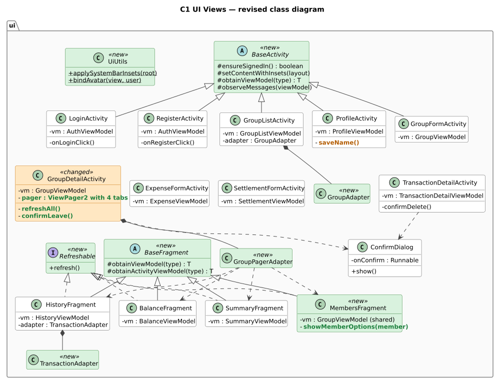

Figure 2a: C1 UI Views. Each screen keeps a reference to the ViewModel it observes.

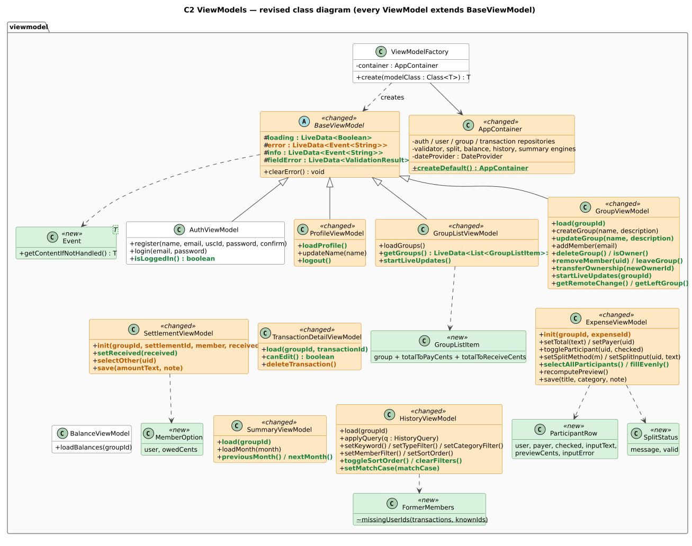

Figure 2b: C2 ViewModels. ExpenseViewModel, SettlementViewModel, TransactionDetailViewModel, BalanceViewModel, HistoryViewModel and SummaryViewModel also extend BaseViewModel; those arrows are omitted for readability.

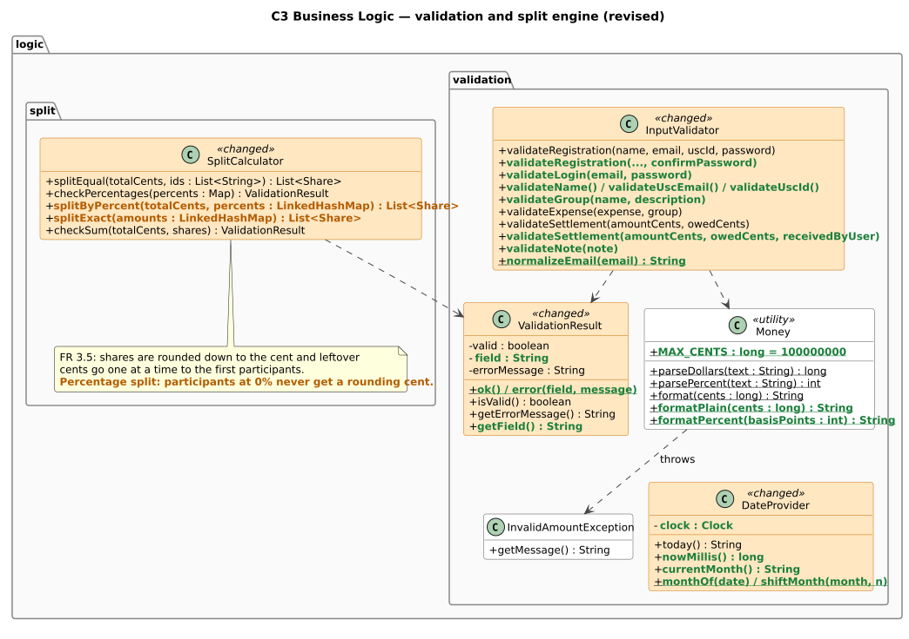

Figure 2c: C3 validation and split engine.

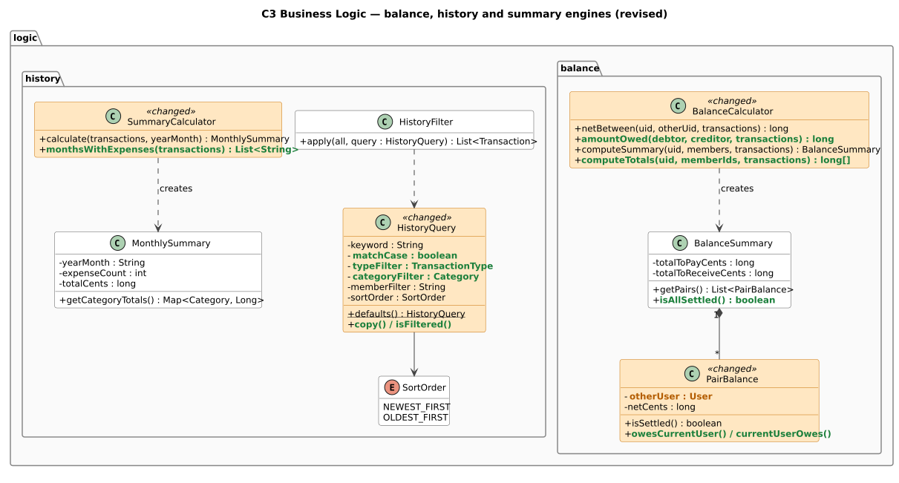

Figure 2d: C3 balance, history and summary engines.

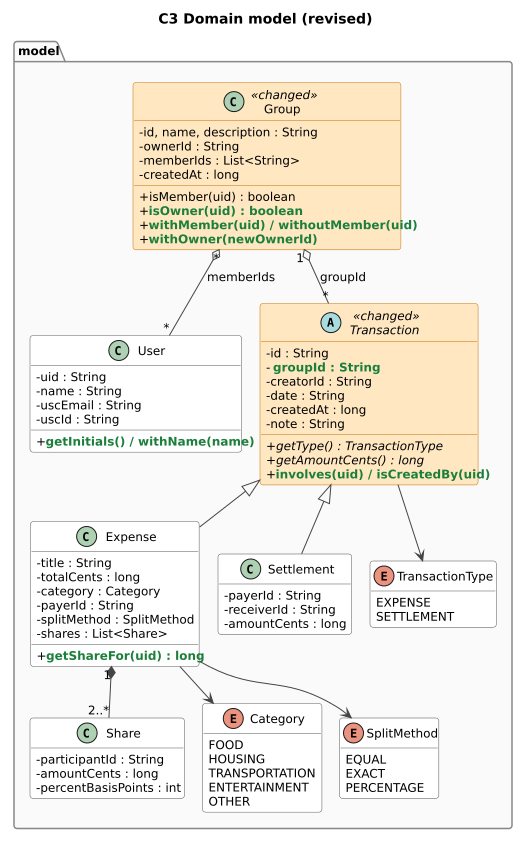

Figure 2e: C3 domain model.

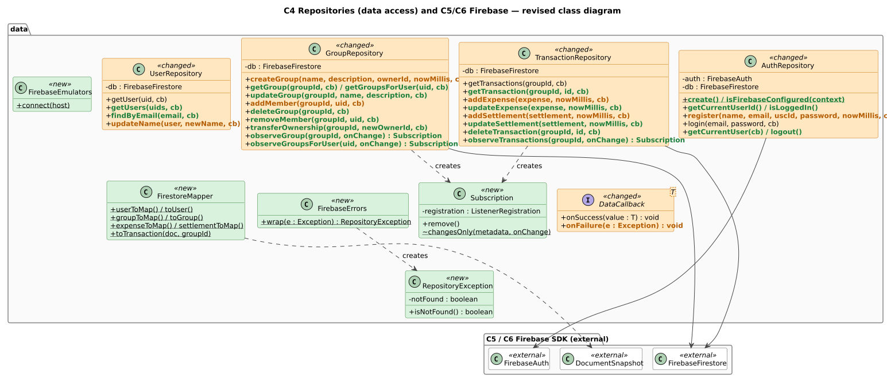

Figure 2f: C4 repositories and the Firebase SDK classes they use. All four repositories use FirebaseFirestore, FirestoreMapper, FirebaseErrors and DataCallback; only AuthRepository uses FirebaseAuth. No class outside this package imports Firebase.

## 5.3 Changes and rationale

**DC-1 CHANGED UI structure (C1).**

| Class | Status | What and why |
|---|---|---|
| `BaseActivity`, `BaseFragment` | NEW | Every screen needs the same setup: a ViewModel from `ViewModelFactory`, a check that the user is still logged in, snackbar messages, and padding for the system bars. Apps targeting Android 15+ are always drawn edge to edge, so content would otherwise slide under the status bar. Putting this in base classes removed the duplication. |
| `GroupDetailActivity` | CHANGED | Now hosts four tabs (History, Balances, Summary, Members) in a `ViewPager2`, plus fixed **Add expense** and **Settle up** buttons. 2.2 listed the three tab fragments but did not say how a user moves between them. |
| `MembersFragment` | NEW | 2.2 had no screen for FR 1.5 / FR 1.6 (view members, owner adds a member by USC email). It shares the activity's `GroupViewModel`, so the toolbar and the list stay consistent. |
| `GroupPagerAdapter` | NEW | Creates the four tab fragments for `ViewPager2`. |
| `GroupAdapter`, `TransactionAdapter` | NEW | `RecyclerView` adapters for the group list and the history list (both can be long). |
| `Refreshable` | NEW | Lets the toolbar's Refresh action reload whichever tabs exist (NFR 3). |
| `UiUtils`, `SimpleTextWatcher` | NEW | Shared formatting (avatars, category icons, "who is involved" text) and a compact text listener. |
| Screens' handler methods | CHANGED | Small renames, e.g. `ProfileActivity.onSaveName()` became `saveName()`; save buttons call the ViewModel directly. |

Further UI decisions: the payer and the settlement receiver are chosen from a dialog list rather
than a drop-down (more reliable across devices); categories are chips with **Other** preselected
(FR 2.5); dates are shown as read-only text ("Date: 2026-10-29 · recorded automatically", FR 2.4);
the history filters are two wrapping rows of chips so they never fight with swiping between tabs;
and every tab reloads its data each time it becomes visible, so changes made elsewhere appear
immediately (FR 2.9, FR 4.5, FR 5.5).

**DC-2 CHANGED Who loads what.** In 2.2 the activities passed a
loaded `Group` object to the forms (`init(group, null)`). Android passes only simple values
between screens, so screens now pass ids in the `Intent`, and each ViewModel loads the group and
members it needs. This also means a form opened after the process was restarted still works.

**DC-3 CHANGED ViewModel API (C2).**

| Class | Project 2.2 | Implemented | Reason |
|---|---|---|---|
| `BaseViewModel` | `error : LiveData<String>`, `clearError()` | `loading`, `error : LiveData<Event<String>>`, `info`, `fieldError : LiveData<ValidationResult>`, `clearError()` | A plain `LiveData<String>` re-delivers the last message after a rotation; `Event` shows it once. `fieldError` lets a form put the message under the right input. |
| `AuthViewModel` | `register(..)`, `login(email, password)` | `register(name, email, uscId, password, confirmPassword)`, `login(..)`, `isLoggedIn()` | Password confirmation (RC-1); returning users skip the login screen. |
| `ProfileViewModel` | `updateName(name)` | + `loadProfile()`, `logout()` | Logging out (FR 1.3) lives on the profile screen. |
| `GroupListViewModel` | `loadGroups()` | `loadGroups()` producing `GroupListItem`s; + `startLiveUpdates()` | Each row also shows the user's totals in that group (extra feature); the list reloads when the user is added to or removed from a group elsewhere (AC-5). |
| `GroupViewModel` | `createGroup(..)`, `addMember(email)` | + `load(groupId)`, `updateGroup(..)`, `deleteGroup()`, `isOwner()`, `getGroupGone()`; + `removeMember(uid)`, `leaveGroup()`, `transferOwnership(uid)`, `getLeftGroup()`, `startLiveUpdates(groupId)`, `getRemoteChange()` | FR 1.6 and FR 1.7 needed load, edit and delete; `groupGone` closes the screen if the group was deleted elsewhere or the user was removed (AC-2). Member management and live updates: DC-9, AC-5. Now also receives `TransactionRepository` and `BalanceCalculator` for the settled-up check. |
| `ExpenseViewModel` | `init(group, null)` + setters, `recomputePreview()`, `save(title, category, note)` | `init(groupId, expenseId)`; same setters (`toggleParticipant` takes the checked state); + `selectAllParticipants()`, `fillEvenly()`; preview published as `ParticipantRow`s and a `SplitStatus` | DC-2; one ViewModel serves both create and edit (FR 2.7); helpers for the split inputs (extra). |
| `SettlementViewModel` | `createSettlement(..)` (class diagram); `selectReceiver`, `save` (Figure 6) | `init(groupId, settlementId, receiverId)`, `selectReceiver(uid)`, `save(amountText, note)` | One ViewModel for create and edit (FR 5.3); the receiver can be preselected from the balance page. |
| `TransactionDetailViewModel` | `editTransaction(..)`, `deleteTransaction(id)` | `load(groupId, transactionId)`, `canEdit()`, `deleteTransaction()` | Editing happens in the two form ViewModels; the detail screen only decides whether Edit and Delete are shown (FR 2.7, FR 5.3). |
| `HistoryViewModel` | `applyQuery(q)`; `load` and setters (Figure 7) | + `toggleSortOrder()`, `clearFilters()` | One-tap sort toggle and a "Clear filters" button. |
| `SummaryViewModel` | `loadMonth(month)` | `load(groupId)`, `loadMonth(month)`, `previousMonth()`, `nextMonth()` | The transactions must be loaded before any month can be summarised; arrows step between months. |
| `AppContainer` | holds repositories | + `createDefault()` | Called by `SplitSmartApp` (AC-1). |
| `Event`, `GroupListItem`, `ParticipantRow`, `SplitStatus`, `ReceiverOption` | — | NEW small immutable state classes | Give each screen exactly the data it renders, so Activities contain no business logic. |
| `FormerMembers` | — | NEW `missingUserIds(transactions, knownIds)` | `HistoryViewModel` and `TransactionDetailViewModel` load the names of people who appear in old transactions but have left the group (DC-9). |

**DC-4 CHANGED Business logic (C3).**

| Class | Change | Reason |
|---|---|---|
| `SplitCalculator` | `splitByPercent` and `splitExact` take a `LinkedHashMap` | FR 3.5 hands leftover cents out "from the first to the last participant", so the order of participants must be preserved by the parameter type. |
| `SplitCalculator` | Leftover cents in a percentage split skip participants at 0% | A member who owes 0% should never owe a rounding cent (RC-4). |
| `ValidationResult` | Adds `field`, `ok()`, `error(field, message)` | The form highlights the input that caused the problem. |
| `InputValidator` | Adds `validateLogin`, `validateName`, `validateUscEmail`, `validateUscId`, `validatePassword`, `validateGroup`, `validateNote`, `normalizeEmail`, and a 5-argument `validateRegistration` | Every form validates before any database call; emails are compared in lower case so uniqueness (FR 1.2) is case-insensitive. |
| `DateProvider` | Takes a `java.time.Clock`; adds `nowMillis()`, `currentMonth()`, `monthOf()`, `shiftMonth()`, `formatMonthLabel()` | Tests can fix the date; the monthly summary needs month arithmetic (FR 5.7). |
| `Money` | Adds `MAX_CENTS`, `formatPlain`, `formatPercent` | Upper limit on amounts (RC-2); refilling inputs when editing; showing percentages. |
| `BalanceCalculator` | Adds `amountOwed(debtor, creditor, txs)` and `computeTotals(uid, memberIds, txs)` | The settlement limit of FR 5.2 is `max(0, -netBetween(…))`; the home screen shows totals per group (extra). |
| `HistoryQuery` | Adds `typeFilter`, `categoryFilter`, `copy()`, `isFiltered()` | The 2.2 class diagram showed only keyword and member filters, although FR 5.6 also requires type and category filters. |
| `SummaryCalculator` | Adds `monthsWithExpenses()` | Lets the month picker list months that have expenses. |

**DC-5 CHANGED Domain model (C3).** `Transaction` gains `groupId`
(so a repository knows where to write) and the fields that were already in the 2.2 Firestore
schema but missing from the class diagram (`date`, `createdAt`, `note`), plus `involves(uid)` and
`isCreatedBy(uid)` used by the member filter and permission checks. `Group` gains
`withMember`, `withoutMember` and `withOwner` (DC-9). `PairBalance` holds the other
`User` instead of only an id, because the balance page shows names and initials. All model
classes are immutable; editing creates a new object with the same id, creator, date and creation
time, which keeps the automatically recorded date fixed (FR 2.4).

**DC-6 CHANGED Data access (C4).**

| Item | Project 2.2 | Implemented | Reason |
|---|---|---|---|
| `DataCallback<T>` | `onSuccess`, `onError` (class diagram) / `onFailure` (sequence diagrams) | `onSuccess(T)`, `onFailure(Exception)` | The 2.2 diagrams disagreed; the sequence-diagram name was kept. |
| `AuthRepository` | `register(..)`, `login(..)` | `register(name, email, uscId, password, nowMillis, cb)`, `login`, `getCurrentUser`, `getCurrentUserId`, `isLoggedIn`, `logout`, `create()`, `isFirebaseConfigured()` | AC-3 flow; session queries used by every screen; AC-1 configuration check. |
| `UserRepository` | `getUser`, `updateName` | + `getUsers(uids, cb)`, `findByEmail(email, cb)`; `updateName(user, newName, cb)` | `getUsers` was already used in Figure 5; `findByEmail` implements FR 1.5. |
| `GroupRepository` | `createGroup`, `addMember` | + `getGroup`, `getGroupsForUser`, `updateGroup`, `deleteGroup`; `addMember(groupId, uid, cb)` | FR 1.6 and FR 1.7; looking up a member by email moved to `UserRepository` so each repository owns one collection. |
| `TransactionRepository` | `addExpense`, `getTransactions`, `addSettlement` | + `getTransaction`, `updateExpense`, `updateSettlement`, `deleteTransaction`; writes take `nowMillis` | FR 2.7 and FR 5.3 (edit, delete) and FR 5.5 (details). Edits use Firestore `update()` so editing a record that someone just deleted fails cleanly instead of recreating it. |
| `FirestoreMapper` | — | NEW | The collection and field names are defined in one place, matching Section 5.4. |
| `FirebaseErrors`, `RepositoryException` | — | NEW | AC-2. |
| Group deletion | "removes the transactions in the same batch" | Transactions are deleted in batches of at most 450 writes and the group document goes in the last batch | Firestore limits a batch to 500 writes; deleting the group last keeps the owner's permission to delete the remaining transactions (AC-4). |
| Group list query | not specified | `memberIds array-contains uid`, sorted in the app | No composite index has to be created in the Firebase console. |
| `GroupRepository` membership | — | NEW `removeMember(groupId, uid, cb)` (`arrayRemove`), `transferOwnership(groupId, newOwnerId, cb)` | DC-9, AC-6. |
| Live updates | — | NEW `GroupRepository.observeGroup`, `observeGroupsForUser`, `TransactionRepository.observeTransactions`, each returning a `Subscription` | AC-5. |
| `FirebaseEmulators` | — | NEW `connect(host)`, used only when the app is built with `-Psplitsmart.emulatorHost=…` | Lets the team test the whole app against the local Firebase emulators without touching the shared project. Normal builds are unaffected. |

**DC-7 CHANGED Settlement limit is checked at save time.** In 2.2
(Figure 6) the amount owed was computed when the receiver was chosen and used later to validate
the amount. If another member recorded a settlement in between, that limit could be stale. The
ViewModel now reads the transactions again when **Save** is pressed and validates against the
fresh amount owed (FR 5.2). When a settlement is edited, the settlement itself is left out of the
calculation, otherwise its own old amount would lower the limit.

**DC-8 CHANGED Platform-driven details.** The minimum Android version
is API 26 so `java.time` can produce the YYYY-MM-DD dates without extra libraries; resource ids
are compared with `if` statements because the Android build tools no longer make them compile-time
constants; and the participant rows of the expense form opt out of Android's automatic view-state
saving because they share view ids — the ViewModel already keeps each member's input across a
screen rotation.

**DC-9 NEW Member management (optional extensions, RC-10).**

| Where | What | Why |
|---|---|---|
| Members tab (owner) | A ⋮ button on every other member opens **Make owner** / **Remove from group**, each with a confirmation dialog | Owner-only actions are offered only to the owner, as for FR 1.5 and FR 1.7. |
| Group menu (other members) | **Leave group**, with a confirmation dialog | The owner must transfer ownership first, so a group always has an owner. |
| `GroupViewModel.removeMember` / `leaveGroup` | Reloads the transactions and uses `BalanceCalculator.computeTotals`; refuses with "… still owes or is owed $X in this group. Settle up first." unless both totals are zero | No debt can disappear when someone leaves, so the balance rules of FR 4 stay correct for everyone who remains. |
| History and Details | Names of former members are loaded from `users/{uid}` (`FormerMembers`) | A removed member's old expenses must still say who paid (FR 5.4, FR 5.5) instead of "Unknown user". |
| Expense and settlement forms | Editing a transaction that involves a former member shows "This expense involves someone who has left the group, so it can no longer be edited."; deleting it is still allowed | The rules require every participant to be a current member (AC-4), so such an edit would be rejected by the server anyway. |
| `GroupRepository.getGroup` | Losing read access is reported as "You are no longer a member of this group." | A removed member's open group screen closes with a clear message (together with AC-5 this happens immediately). |

## 5.4 Data storage (revised)

Firebase Authentication still stores each email and password hash. Firestore stores everything
else:

| Firestore path | Fields | Status |
|---|---|---|
| `users/{uid}` | `name`, `uscEmail` (lower case), `uscId`, `createdAt` | CHANGED + `createdAt` |
| `uscIds/{uscId}` | `uid` — reserves the USC ID (FR 1.2) | UNCHANGED |
| `groups/{groupId}` | `name`, `description`, `ownerId`, `memberIds`, `createdAt` | UNCHANGED |
| `groups/{groupId}/transactions/{id}` | `type`, `creatorId`, `date`, `createdAt`, `updatedAt`, `note`; expense: `title`, `totalCents`, `category`, `payerId`, `splitMethod`, `shares` (each `participantId`, `amountCents`, `percentBasisPoints`), `participantIds`; settlement: `payerId`, `receiverId`, `amountCents` | CHANGED + `updatedAt`, + `participantIds` |

`participantIds` duplicates the ids inside `shares` because security rules cannot loop over a list
of maps; with a plain list the rules can check that every participant is a member (AC-4).

## 5.5 Security rules (revised)

| Data | Project 2.2 | Implemented (`firestore.rules`) |
|---|---|---|
| Groups: read | members only | members only; reading a group that no longer exists is allowed (AC-4) |
| Groups: create | — | the creator must be the owner and the only member; a name is required |
| Groups: change | owner only | owner: edit details and add or remove members while staying a member, or transfer ownership to an existing member (nothing else in that write); any other member: remove only themselves (AC-6) |
| Groups: delete | owner only | owner only |
| Transactions: read | members only | members only |
| Transactions: create | — | members only; `creatorId` is the caller; expense and settlement contents are checked (AC-4) |
| Transactions: edit | creator only | creator only; creator and type cannot change; contents are checked |
| Transactions: delete | creator only | creator, **or the group owner** (needed for FR 1.7) |
| `users` | — | signed-in users can read profiles; each user creates only their own profile with a `@usc.edu` email matching their login and a 10-digit USC ID; only `name` can be updated |
| `uscIds` | — | signed-in users can read a single reservation but not list them; a reservation can only be created for yourself and is never changed |

## 5.6 Revised sequence diagrams

| Figure | Interaction | Status | Main differences from Project 2.2 |
|---|---|---|---|
| 3 | Register an account | CHANGED | Login created first; USC ID checked and reserved inside the transaction; rollback (AC-3); confirm password. |
| 4 | Create an expense with a split preview | CHANGED | `init(groupId, null)` loads the group and members (DC-2); preview published as rows and a status. |
| 5 | View the balance page | CHANGED | `loadBalances(groupId)` reloads the group first; balances sorted; reloads whenever the tab is shown. |
| 6 | Record a settlement | CHANGED | Data loaded once in `init`; `amountOwed`; fresh re-check at save time (DC-7). |
| 7 | Search, filter and sort the history | CHANGED | Members loaded for names and the member filter; `clearFilters()`; result count. |
| 8 | Delete a group | NEW | Batched deletion and the owner-delete rule (AC-4, DC-6). |
| 9 | Remove a member or leave a group | NEW | Settled-up check, then `arrayRemove`; new rules (AC-6, DC-9). |
| 10 | Live updates | NEW | Snapshot listener, change event, reload of every tab (AC-5). |

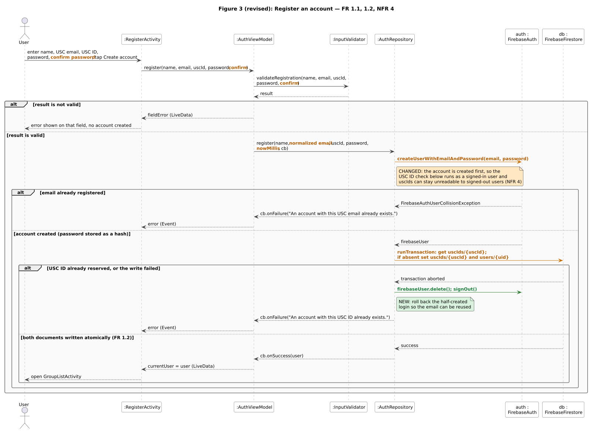

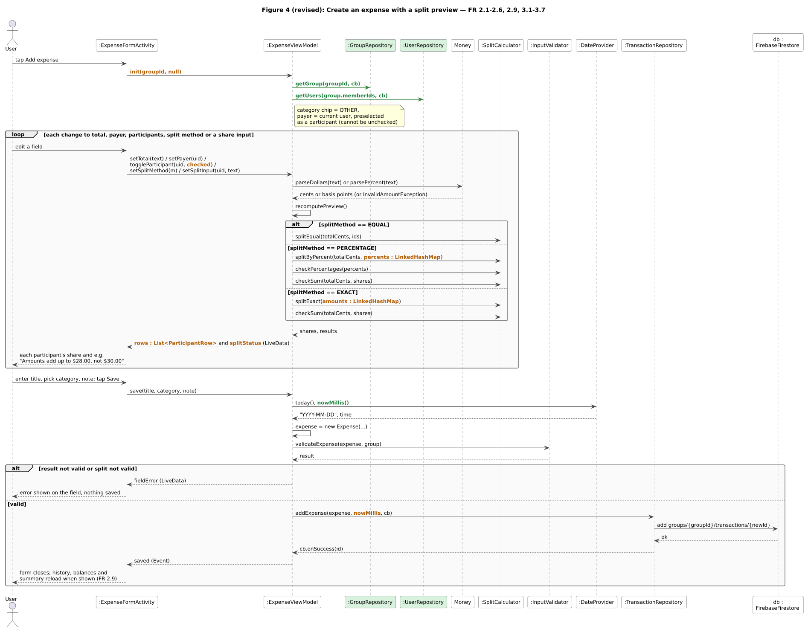

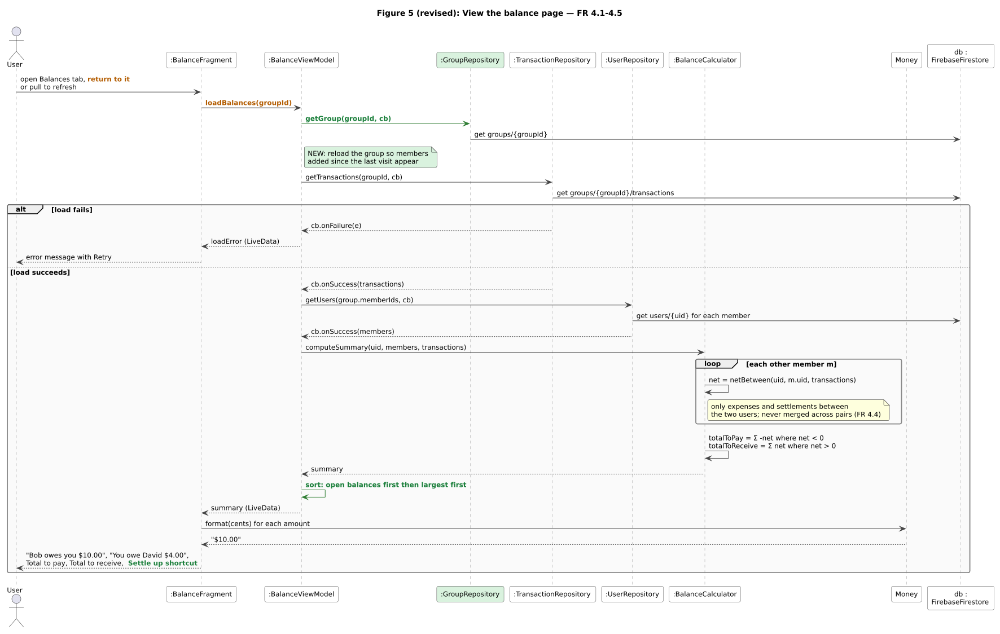

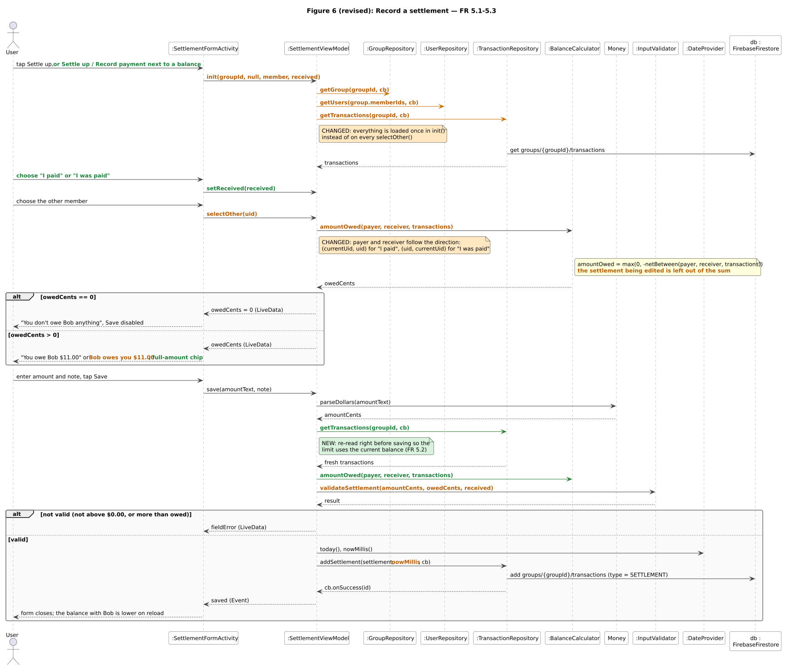

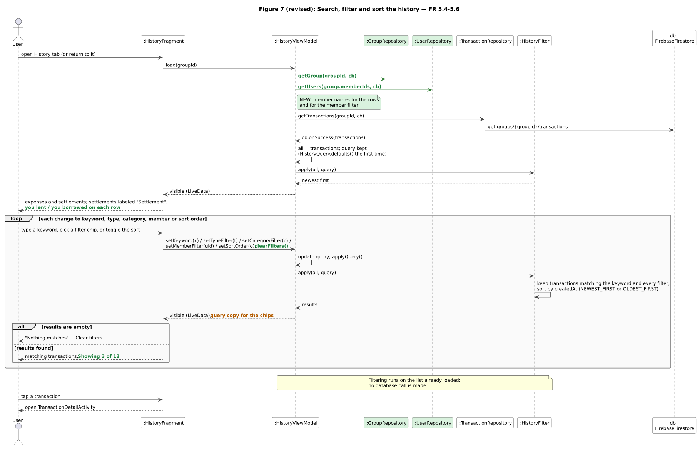

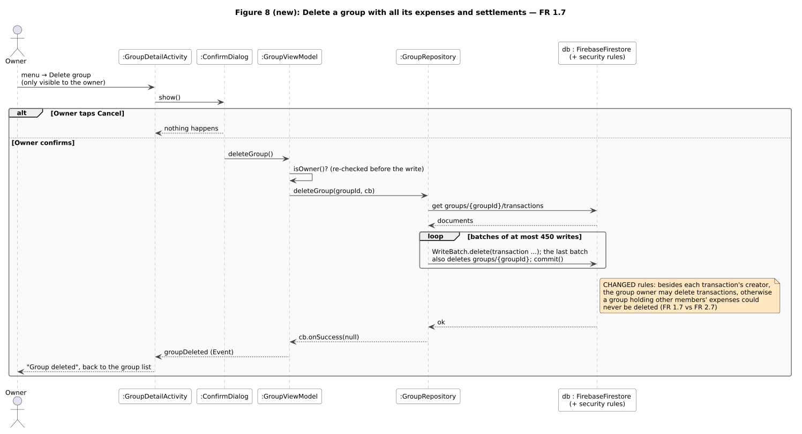

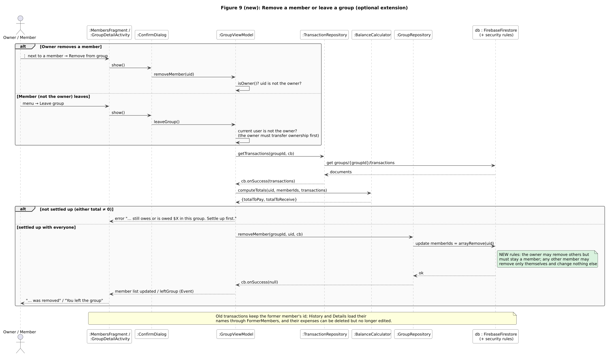

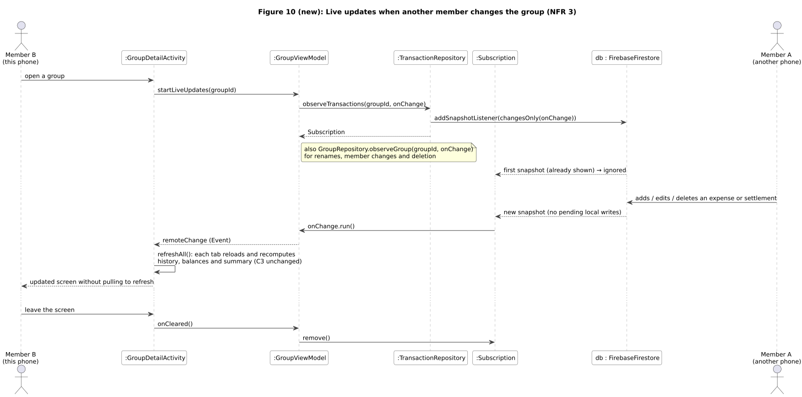

# 6. Requirements Change

No requirement from Project 2.1 was removed or postponed: FR 1.1 – FR 5.7 and NFR 1 – NFR 4 are
all implemented (see Appendix A). The changes below clarify requirements that turned out to be
underspecified when the forms were built (RC-1 to RC-9), followed by optional requirements that we
added and implemented (RC-10, RC-11) and one we analysed for a later assignment (RC-12).

**RC-1 Password rules (FR 1.1).** Passwords must have at least 6 characters, and registration asks
for the password twice.
*Does it change the design?* Yes, slightly. *What and how:* `InputValidator` gains
`validatePassword` and a 5-argument `validateRegistration`; `RegisterActivity` gains a
confirmation field; `AuthViewModel.register` takes the confirmation. No architectural change:
Firebase Authentication already enforces the 6-character minimum.

**RC-2 Upper limit on amounts (FR 2.3, FR 5.2).** Amounts may not exceed $1,000,000.00.
*Does it change the design?* Yes, slightly: `Money.MAX_CENTS` and checks in `Money.parseDollars`
and `InputValidator.validateExpense`. It prevents typos and keeps every product of an amount and a
percentage far inside the range of a `long`. No other component is affected.

**RC-3 Length limits (FR 1.3, 1.4, 2.2, 5.1).** Names and group names up to 50 characters, expense
titles up to 60, group descriptions up to 200, notes up to 300.
*Does it change the design?* Only constants in `InputValidator` and counters on the text fields;
the security rules also limit profile names to 50 characters. Keeps lists readable and documents
small.

**RC-4 Percentage rounding and 0% participants (FR 3.4, FR 3.5).** When a percentage split leaves
extra cents, they are handed out from the first to the last participant as before, but
participants assigned 0% are skipped.
*Does it change the design?* No change to any interface — only the algorithm inside
`SplitCalculator.splitByPercent`. Shares still add up exactly to the total, and equal splits are
unaffected because nobody has 0% there. Covered by `SplitCalculatorTest`.

**RC-5 Every participant needs an entered value (FR 3.3, FR 3.4).** In exact and percentage splits
the form cannot be saved while a selected participant's box is empty; entering 0 is allowed for a
member who owes nothing.
*Does it change the design?* No; it is a rule inside `ExpenseViewModel.recomputePreview()`, which
already decides whether the split is valid (FR 3.6).

**RC-6 Category filter applies to expenses (FR 5.6).** Settlements have no category, so choosing a
category shows only expenses of that category, and choosing the "Settlements" type clears the
category filter.
*Does it change the design?* No; handled inside `HistoryFilter` and `HistoryViewModel`.

**RC-7 Settlement limit when editing and at save time (FR 5.2, FR 5.3).** The "current amount owed"
for an edited settlement excludes that settlement, and the limit is re-checked when Save is
pressed.
*Does it change the design?* Yes: `SettlementViewModel` reloads the transactions inside `save()`,
and `BalanceCalculator.amountOwed` was added (DC-7, Figure 6).

**RC-8 Group owner and other members' transactions (FR 1.7 vs FR 2.7).** Deleting a group must
delete every expense and settlement in it, including ones created by other members. The server
therefore lets the owner delete any transaction in the group; the app only uses that when the
whole group is deleted, so individual transactions can still only be edited or deleted by their
creator.
*Does it change the design?* Yes, in C6 only: one rule in `firestore.rules` (AC-4). No class
changes.

**RC-9 Only the member who owes records the settlement (FR 5.1).** The payer of a settlement is
always the logged-in user, and the server rejects a settlement recorded on someone else's behalf.
*Does it change the design?* No change to classes (it matches the 2.2 design); the rule is now
also enforced on the server (AC-4).

**RC-10 (added, implemented) Remove members, leave a group, transfer ownership.** These were
optional extensions in the customer description. The owner may remove a member or make another
member the owner; any other member may leave. Nobody can leave or be removed while they still owe
or are owed money in the group, and the owner must transfer ownership before leaving.
*Does it change the design?* Yes, as predicted in version 2.0 of this document, and it was
implemented that way: `GroupRepository` gained `removeMember` and `transferOwnership`;
`GroupViewModel` gained `removeMember`, `leaveGroup` and `transferOwnership`, which use
`BalanceCalculator` to require a zero balance; the security rules allow exactly these three
changes (AC-6); and history and detail screens load the names of users referenced by old
transactions (`FormerMembers`). One consequence we had not predicted: an expense or settlement
that involves a former member can no longer be edited (only deleted), because the rules require
every participant to be a current member (DC-9).

**RC-11 (added, implemented) Live updates.** Open screens show other members' changes immediately,
without pulling to refresh. NFR 3 is still met in the original way as well (screens reload when
shown, and pull to refresh still works).
*Does it change the design?* Yes, in C2 and C4 only, as predicted: repositories offer
`observeGroup`, `observeGroupsForUser` and `observeTransactions` using Firestore snapshot listeners
and return a `Subscription` handle; ViewModels keep the handles and remove them in `onCleared()`
(AC-5). The C3 engines and the screens' rendering code did not change; the screens reuse their
refresh method.

**RC-12 (future) Notifications** when a user is added to a group or an expense involves them.
*Does it change the design?* Yes: a new backend component (Firebase Cloud Messaging plus a Cloud
Function that reacts to new transactions), a device-token field in `users/{uid}`, and a
notification permission request in C1. The existing components would otherwise be unchanged.

# Appendix A — Requirement traceability

| Requirement | Where in the app | Main classes | Verified by |
|---|---|---|---|
| FR 1.1 | Create account screen | `RegisterActivity`, `AuthViewModel`, `InputValidator`, `AuthRepository` | `InputValidatorTest`; rules tests (users) |
| FR 1.2 | Create account screen | `AuthRepository` (transaction on `uscIds`), Firebase Authentication | rules tests (uscIds) |
| FR 1.3 | Login, Profile | `LoginActivity`, `ProfileActivity`, `ProfileViewModel`, `UserRepository` | rules tests (only the name can change) |
| FR 1.4 | Home → New group | `GroupFormActivity`, `GroupViewModel`, `GroupRepository` | rules tests (groups) |
| FR 1.5 | Group → Members tab | `MembersFragment`, `GroupViewModel.addMember`, `UserRepository.findByEmail` | rules tests (owner adds members) |
| FR 1.6 | Home list, Members tab | `GroupListActivity`, `MembersFragment` | rules tests (members-only reads) |
| FR 1.7 | Group menu (owner only) | `GroupDetailActivity`, `ConfirmDialog`, `GroupRepository.deleteGroup` | rules tests (owner deletes group) |
| FR 2.1 – 2.6 | Add expense | `ExpenseFormActivity`, `ExpenseViewModel`, `InputValidator.validateExpense` | `InputValidatorTest`; rules tests (expense contents) |
| FR 2.7 – 2.9 | Transaction details → Edit / Delete | `TransactionDetailActivity`, `TransactionDetailViewModel`, `TransactionRepository` | rules tests (creator-only edit and delete) |
| FR 3.1 – 3.7 | Expense form preview | `SplitCalculator`, `ExpenseViewModel.recomputePreview` | `SplitCalculatorTest`, `BalanceCalculatorTest` |
| FR 4.1 – 4.5 | Balances tab | `BalanceFragment`, `BalanceViewModel`, `BalanceCalculator` | `BalanceCalculatorTest` (customer examples) |
| FR 5.1 – 5.3 | Settle up | `SettlementFormActivity`, `SettlementViewModel`, `InputValidator.validateSettlement` | `InputValidatorTest`, `BalanceCalculatorTest`, rules tests |
| FR 5.4 – 5.6 | History tab | `HistoryFragment`, `HistoryViewModel`, `HistoryFilter` | `HistoryFilterTest` |
| FR 5.7 | Summary tab | `SummaryFragment`, `SummaryViewModel`, `SummaryCalculator` | `SummaryCalculatorTest` |
| NFR 1 | All data | Cloud Firestore (with its local cache) | Close and reopen the app |
| NFR 2 | All amounts | `Money` (`long` cents, "$0.00" format) | `MoneyTest` |
| NFR 3 | All screens | Screens reload when shown; pull to refresh; live updates (AC-5) | Two devices; emulator test with remote writes |
| RC-10 (extension) | Members tab, group menu | `GroupViewModel.removeMember / leaveGroup / transferOwnership`, `GroupRepository` | rules tests (leave, remove, transfer); emulator end-to-end test |
| RC-11 (extension) | Group list, every group tab | `Subscription`, `observe…` methods, `GroupViewModel.startLiveUpdates` | emulator end-to-end test |
| NFR 4 | Server | Firebase Authentication (hashed passwords), `firestore.rules` | 22 rules tests |

# Appendix B — Extra features

These go beyond the required features and do not replace any of them.

1. **Home dashboard:** each group shows what you owe or are owed in it, plus overall totals.
2. **"You lent / you borrowed"** on every history row, and who paid whom for settlements.
3. **Settle-up shortcut** next to each debt on the balance page, and a **Pay the full amount**
   button on the settlement form.
4. **Split helpers:** "Select all" participants, "Fill evenly" for exact and percentage splits,
   and live hints such as "$2.00 left to assign".
5. **Share balances** as text through any messaging app.
6. **Monthly summary:** month picker listing the months that have expenses, and a bar with the
   percentage for each category (charts were optional).
7. **History count and Clear filters:** "Showing 3 of 12" whenever filters are active.
8. **USC cardinal and gold Material 3 design** with dark mode and initials avatars.
9. **Offline viewing** of previously loaded data through Firestore's local cache.
10. **Clear handling of deleted data:** if a group or transaction was deleted on another phone,
    the screen says so instead of showing an error, and a deleted group's page closes itself.
11. **Member management** (optional extension, RC-10): remove a member, leave a group, transfer
    ownership, with a guard that nobody leaves while money is still owed.
12. **Live updates** (RC-11): the group list, history, balances, summary and members update the
    moment another member makes a change, and a removed member's screen closes immediately.

# Appendix C — Verification

| Check | Scope | Result |
|---|---|---|
| Unit tests (`./gradlew test`) | `Money`, `SplitCalculator`, `BalanceCalculator`, `InputValidator`, `HistoryFilter`, `SummaryCalculator`, `DateProvider`, model — including every worked example in the customer description | 71 tests, all passing |
| Security-rule tests (`firestore-tests/`, Firestore emulator) | Documents shaped exactly like the app writes them; members-only access, owner and creator permissions, locked fields, USC ID uniqueness, content validation, batched group deletion | 25 tests, all passing (including leave, remove and transfer ownership) |
| Full Gradle build | `./gradlew assembleDebug` with the real AndroidX, Material and Firebase libraries | Builds with no errors |
| End-to-end test on an emulator | Android 15 emulator against the local Firebase Auth and Firestore emulators: registration (with every error case), login, profile, groups, members, equal and percentage splits with rounding, balances, settlements and their limits, history search, summary, remove / leave / transfer ownership, group deletion; live updates checked by writing to the database from outside the app | All passed |
| Manual end-to-end test | The step-by-step script in `README.md` (section 4), using two devices to show that one member's changes reach the others | Carried out while recording the demo video |
